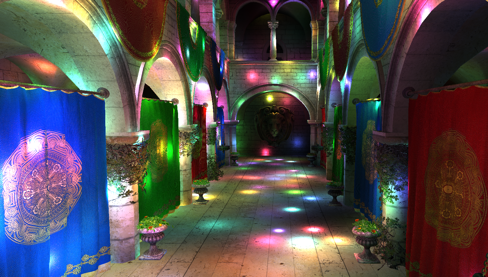
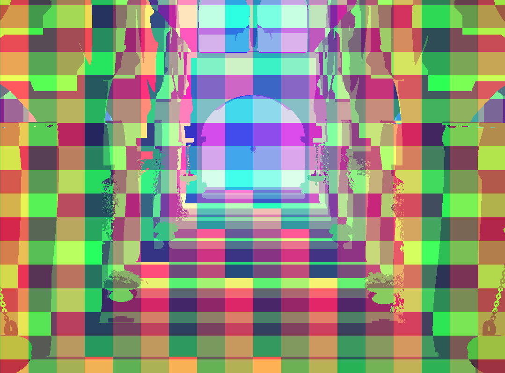
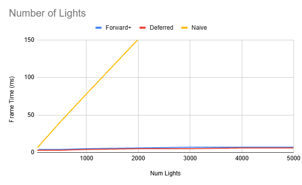
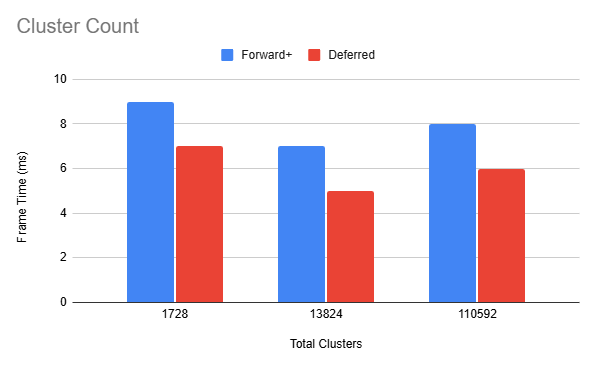

WebGPU Forward+ and Clustered Deferred Shading
======================

**University of Pennsylvania, CIS 565: GPU Programming and Architecture, Project 4**

* Kevin Du
  * [LinkedIn](https://www.linkedin.com/in/kevinwdu/), [personal website](https://kevindu.dev)
* Tested on: Windows 11, Intel Core Ultra 5 225F @ 3.30 GHz, 32 GB RAM, RTX 5060 (8 GB)

## Live Demo

[Live Demo](https://kevinwd2401.github.io/WebGPU-Forward-Plus-and-Clustered-Deferred/)

### Results

### Demo Video

## Features

This is a real-time renderer built with WebGPU, TypeScript, and WGSL. It implements Naive Forward, Forward+, and Clustered Deferred rendering in the Sponza scene, with animated point lights and interactive controls for switching between renderers and adjusting the light count.

### Naive Forward

Naive Forward renders the geometry in a single pass. Each shaded fragment loops through every light and accumulates its contribution.

### Forward+

Forward+ divides the camera frustum into screen-space tiles and logarithmic depth slices to create clusters. A depth pre-pass identifies visible surfaces, and a compute pass assigns lights to clusters via light indices. Each light's sphere of influence is tested against the cluster's six frustum planes.

The final color pass uses the pixel's cluster ID to evaluate the relevant light list. The depth pre-pass avoids lighting hidden surfaces.

*The colors visualize cluster assignment across the scene for light culling. Screen-space tile boundaries form a grid, paritioned further by depth.*

### Clustered Deferred

Clustered Deferred uses the same depth pre-pass and light-clustering sequence. A geometry pass then stores world position and normal in two `rgba16float` textures, and albedo in an `rgba8unorm` texture, alongside the `depth24plus` depth buffer. A single fullscreen triangle reads these textures and computes lighting for visible pixels.

The lighting pass reuses the saved cluster ID rather than reconstructing it from the half-float position, avoiding incorrect assignments near depth-slice boundaries.

Both clustered renderers store up to 256 lights per cluster. A `clusterOverflowFallback` setting evaluates all scene lights when a cluster overflows, removing grid artifacts and preserving lighting at the cost of performance. Disabling it in `src/shaders/shaders.ts` enforces the cap and can omit lights.

## Performance Analysis

The supplied benchmark data records a resolution of **1920 × 911**, a **256-light cluster capacity**, and **64 invocations per clustering workgroup** (`4 × 4 × 4`). The light-count benchmark uses `32 × 18 × 24` clusters, and the cluster-count m uses 3,000 lights. The current implementation uses `64 × 1 × 1` workgroups for compaction and culling, `8 × 8` for pixel assignment.

Timings below are frame times in milliseconds, with a sampling interval over 5 seconds.

### Number of Lights

Naive Forward grows from **6 ms at 50 lights to 385 ms at 5,000 lights**, approximately following the light count. This linear increase makes sense because each shaded fragment evaluates every light. Over the same range, Forward+ grows from **3 ms to 7 ms**, and Clustered Deferred grows from **3 ms to 6 ms**. Clustering keeps these times much flatter since by rejecting lights not in the cluster. Frame times do not grow much further after 3000 lights, likely because the light cap per cluster has already been reached at that light density, so more lights will not increase the number of lights a fragment has to evaluate.

Clustered Deferred ties or beats Forward+ at every sampled light count, usually by 1 ms. Separating material evaluation from a fullscreen lighting pass may make lighting execution more efficient here, enough to offset G-buffer read aqnd writes.

Both clustered methods are already faster at the lowest tested count of 50 lights, so these measurements show no crossover where Naive Forward wins. But with fewer lights or a simpler scene, the extra clustering and G-buffer passes could become a larger share of the frame time.

### Cluster Count

At **32 × 18 × 24 (13,824 clusters)**, the renderers perform best among the tested configurations at **7 ms for Forward+ and 5 ms for Clustered Deferred**. The smaller `16 × 9 × 12` grid has 1,728 clusters and takes 9 ms and 7 ms. Larger clusters likely admit more lights that do not affect every pixel inside them, becoming closer to naive and increasing fragment lighting work.

Increasing the grid to `64 × 36 × 48` creates 110,592 clusters and raises the times to 8 ms and 6 ms. Finer clusters can shorten light lists, but they also require more storage and a larger compaction scan, with potentially more occupied clusters to process. At this size, the extra clustering work appears to outweigh the shading savings. Additionally, artifacting becomes a more visible issue.

### Credits

- [Vite](https://vitejs.dev/)
- [loaders.gl](https://loaders.gl/)
- [dat.GUI](https://github.com/dataarts/dat.gui)
- [stats.js](https://github.com/mrdoob/stats.js)
- [wgpu-matrix](https://github.com/greggman/wgpu-matrix)
