WebGPU Forward+ and Clustered Deferred Shading
==============================================

**University of Pennsylvania, CIS 5650: GPU Programming and Architecture, Project 4**

* Ximing Luo
* Tested on: Google Chrome 155.0.8059.80 on Windows 11 Home, AMD Ryzen 9 8945HS @ 4.0GHz 32GB, AMD Radeon 780M (integrated) (personal laptop)

### Live Demo

[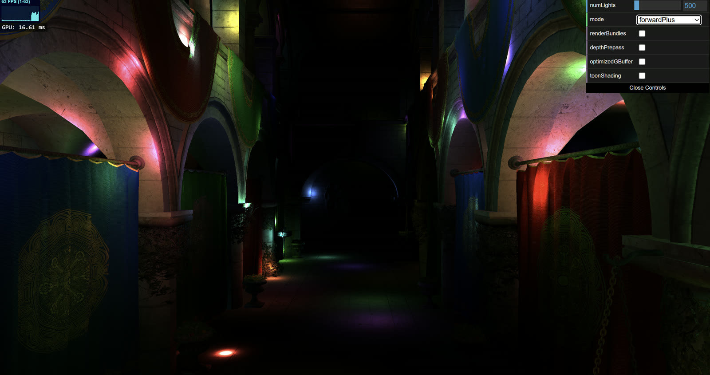](https://ximluo.github.io/Project4-WebGPU-Forward-Plus-and-Clustered-Deferred)

Needs a WebGPU browser. The panel in the top right sets the light count, the renderer and the extras.

### Demo Video/GIF

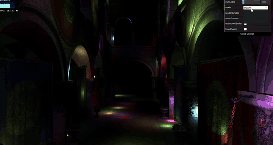

## Overview

The Sponza atrium from the base code, up to 5000 moving point lights, and three renderers you can switch between while it runs:

* **Naive forward.** Every fragment loops over every light.
* **Forward+.** A compute shader sorts the lights into a 16 x 9 x 24 cluster grid each frame. A fragment only loops over the lights in its cluster.
* **Clustered Deferred.** Same clustering, but geometry goes into a G-buffer first and lighting runs once per pixel in a fullscreen pass.

Extras, each behind a GUI checkbox: render bundles (Forward+ and Clustered Deferred), depth prepass (Forward+), optimized G-buffer with a compute lighting pass (Clustered Deferred), and a toon post-process (Clustered Deferred, with the optimized G-buffer on).

The number in the corner is GPU time per frame from WebGPU timestamp queries, averaged over the last 30 frames.

| | | |
|:--:|:--:|:--:|
|  | 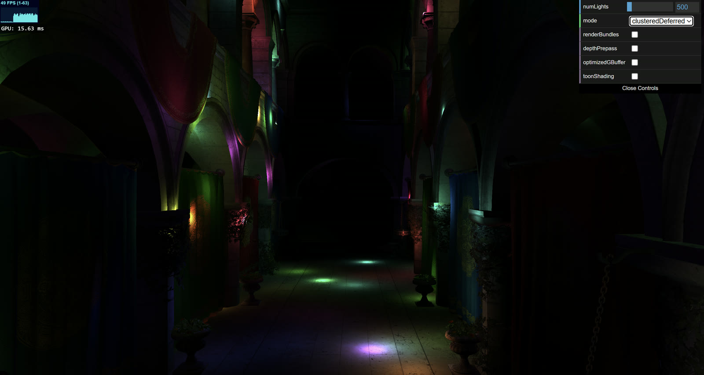 | 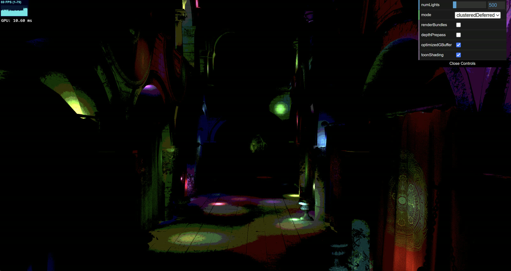 |
| Forward+, 500 lights | Clustered Deferred, 500 lights | Toon shading |

## How it works

**Clusters.** 16 x 9 screen tiles and 24 depth slices, log spaced from 1 to 100 view-space units. The first slice starts at the near plane and the last ends at the far plane, so every fragment lands in a cluster. Each cluster stores a light count and up to 1024 light indices.

**Clustering shader.** One thread per cluster. It builds the cluster's view-space AABB from the tile's NDC bounds (at distance `d`, x spans `ndc * d / proj[0][0]` and y spans `ndc * d / proj[1][1]`, taken at the slice's near and far distance) and tests every light sphere against it. Tile y is flipped because framebuffer y points down.

**Forward+ fragment shader.** Picks the cluster from the pixel position and view depth, then loops over that cluster's lights. The cluster is read through a pointer.

**Clustered Deferred.** G-buffer: world position (`rgba32float`), normal (`rgba16float`), albedo (`rgba8unorm`) plus depth. A fullscreen triangle reads them with `textureLoad` and runs the same light loop.

**Render bundles.** The scene's bind groups and draw calls are recorded once into a `GPURenderBundle` and replayed each frame.

**Depth prepass.** A depth-only pass first (its fragment shader only does the alpha-mask discard), then the lighting pass with depth writes off and `less-equal`, so each pixel is shaded once. 

**Optimized G-buffer.** One `rg32uint` texture: albedo packed with `pack4x8unorm`, octahedral normal with `pack2x16snorm`. Position is rebuilt from depth with the inverse view-projection matrix. Lighting runs in an 8 x 8 compute shader that writes an `rgba8unorm` storage texture, which is copied to the canvas (the canvas is configured as `rgba8unorm`).

**Toon.** A second compute pass quantizes color to 5 levels and paints a pixel black when a neighbour's linear depth differs by more than 10 percent.

## Running it

```
npm install
npm run dev
```

Hold the left mouse button and drag to look, WASD to move, Q/E down and up, Shift faster, Alt slower. `npm run build` writes the site to `dist/`; its `cp -r` needs Git Bash on Windows.

## Performance

GPU milliseconds per frame from the timestamp queries. Default camera, 2848 x 1518 canvas (1424 x 759 window at 2x DPR), 16 x 9 x 24 grid, depth range 1 to 100, no toggles unless stated. Chrome ran on the integrated Radeon 780M, so absolute numbers are high. Run-to-run noise is about 1 ms.

### Light count

| Lights | Naive | Forward+ | Clustered Deferred |
|---:|---:|---:|---:|
| 500 | 159.0 | 11.4 | 17.6 |
| 1000 | 323.7 | 20.5 | 16.1 |
| 2000 | 646.2 | 38.4 | 20.0 |
| 3000 | 933.4 | 59.1 | 25.0 |
| 5000 | 2544.9 | 96.5 | 33.2 |

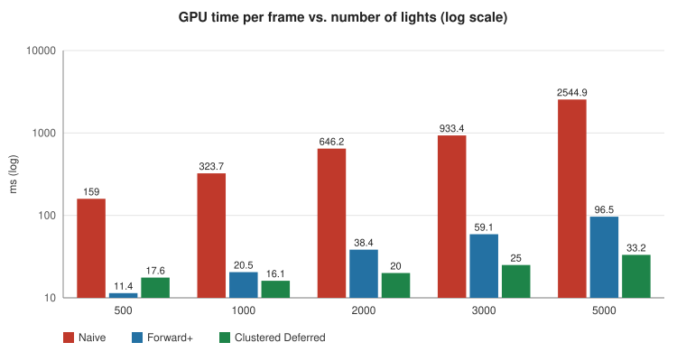

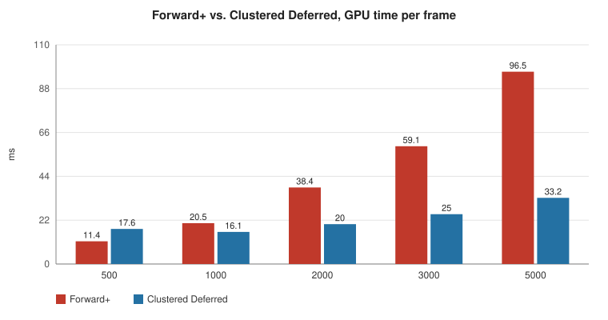

Naive grows linearly with the light count and shades every overdrawn fragment. (The 5000-light frame takes over a second and gets preempted by the compositor, which pushes it above linear.) Forward+ is about 10x faster because each fragment only visits its cluster's lights, but it still shades overdrawn fragments, so it keeps growing. Clustered Deferred shades each pixel once and grows the slowest, but its fixed cost is higher: the G-buffer pass writes and reads 28 bytes per pixel, which is why it loses to Forward+ at 500 lights on this bandwidth-limited GPU. Deferred wins with many lights or heavy overdraw. Forward+ wins when lighting is cheap, and it keeps transparency and MSAA simple.

### Cluster grid size

2000 lights, depth range 0.1 to 1000 (before the tuning below).

| Grid | Clusters | Forward+ | Clustered Deferred |
|---|---:|---:|---:|
| 8 x 5 x 12 | 480 | 112.3 | 35.2 |
| 16 x 9 x 24 | 3456 | 57.1 | 24.1 |
| 32 x 18 x 32 | 18432 | 45.8 | 22.0 |

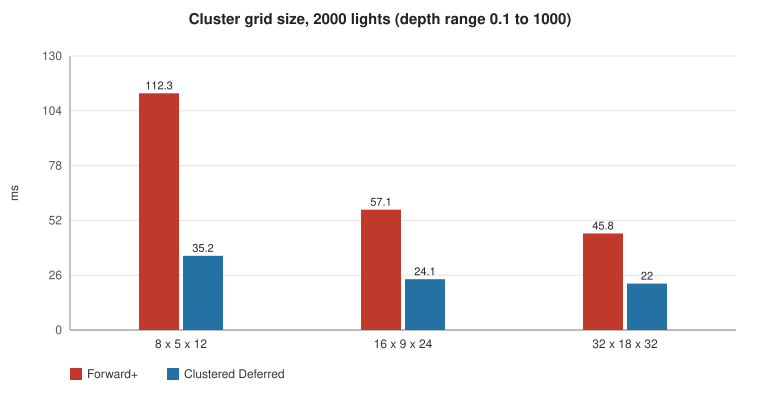

Smaller clusters hold fewer lights: going from 480 to 3456 clusters halves the Forward+ time. 18432 helps less because the clustering pass does 5x more light tests, the cluster buffer grows to 75 MB, and the clusters get smaller than the light radius. 16 x 9 x 24 is the default.

### Cluster depth range

2000 lights, 16 x 9 x 24 grid.

| Depth slices | Forward+ | Clustered Deferred |
|---|---:|---:|
| log 0.1 to 1000 (camera near/far) | 57.1 | 24.1 |
| log 0.1 to 100 | 46.9 | 21.0 |
| log 1 to 100, ends extended to near/far | 39.3 | 19.6 |

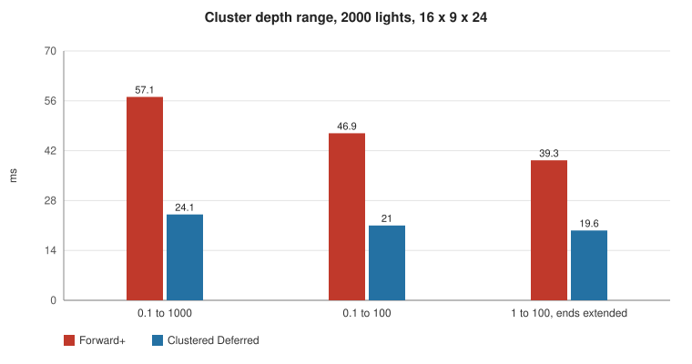

With slices from 0.1 to 1000, only about ten of the 24 slices covered the scene (it is roughly 1 to 50 units deep). Slicing 1 to 100 makes the slices that hold geometry thinner, so they hold fewer lights: Forward+ got 31 percent faster and Deferred 19 percent.

### Render bundles

| | Direct draw calls | Render bundles |
|---|---:|---:|
| Forward+, CPU ms per frame | 0.553 | 0.435 |
| Clustered Deferred, CPU ms per frame | 0.948 | 0.694 |
| Forward+, GPU ms, 500 / 5000 lights | 11.4 / 96.5 | 10.8 / 95.4 |
| Clustered Deferred, GPU ms, 500 / 5000 lights | 17.6 / 33.2 | 14.0 / 33.9 |

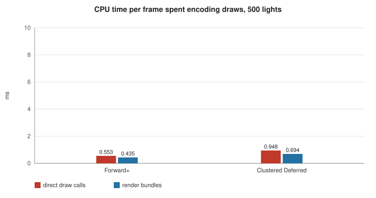

Bundles only save CPU time (JavaScript time inside the frame callback): 21 to 27 percent less encoding per frame. GPU time is unchanged. Best case: thousands of draw calls on a CPU-bound frame. Worst case: this scene, about a hundred draw calls and a GPU-bound frame.

### Depth prepass

| Lights | Forward+ | With depth prepass |
|---:|---:|---:|
| 500 | 11.4 | 8.3 |
| 5000 | 96.5 | 38.6 |

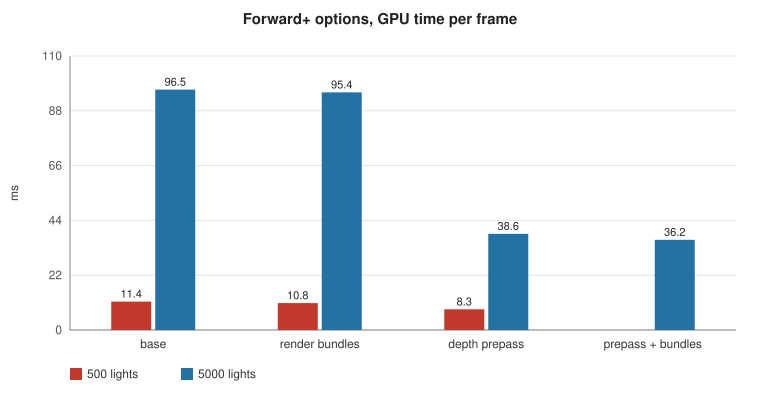

One extra geometry pass (about 4 ms) buys shading each pixel once: 27 percent faster at 500 lights, 2.5x at 5000. Best case: heavy overdraw and many lights. Worst case: no overdraw and few lights, where the extra pass is pure cost. With the prepass, Forward+ at 5000 lights (38.6 ms) is close to Clustered Deferred (33.2 ms).

### Optimized G-buffer and compute lighting

| Lights | Default (3 textures, 28 B/px, fullscreen triangle) | Optimized (1 texture, 8 B/px, compute pass) | Optimized + toon |
|---:|---:|---:|---:|
| 500 | 17.6 | 8.8 | 8.8 |
| 5000 | 33.2 | 30.2 | 29.3 |

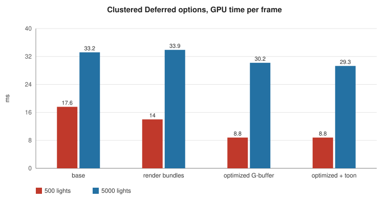

Per-pixel G-buffer data drops from 28 to 8 bytes. At 500 lights the frame is bandwidth-bound and the time halves. At 5000 the light loop dominates and the gain is about 10 percent. The cost is a few extra ALU ops for packing, unpacking and position reconstruction.

### Toon

About 0.1 ms, independent of the light count (one color and five depth reads per pixel), inside the noise.

### Credits

- [Vite](https://vitejs.dev/)
- [loaders.gl](https://loaders.gl/)
- [dat.GUI](https://github.com/dataarts/dat.gui)
- [stats.js](https://github.com/mrdoob/stats.js)
- [wgpu-matrix](https://github.com/greggman/wgpu-matrix)
- [A Primer On Efficient Rendering Algorithms & Clustered Shading](https://www.aortiz.me/2018/12/21/CG.html), clustering reference
- [A Survey of Efficient Representations for Independent Unit Vectors](https://jcgt.org/published/0003/02/01/), octahedral normals
- [WebGPU render bundles best practices](https://toji.dev/webgpu-best-practices/render-bundles.html)
