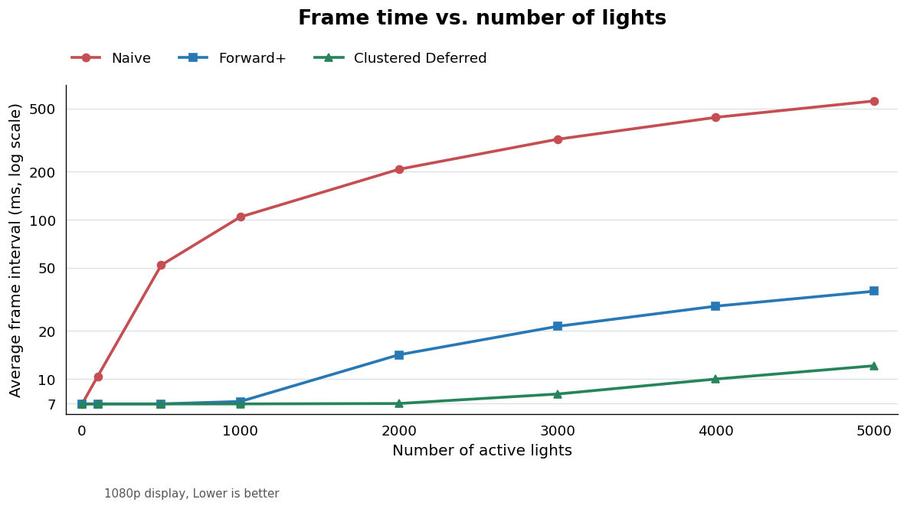
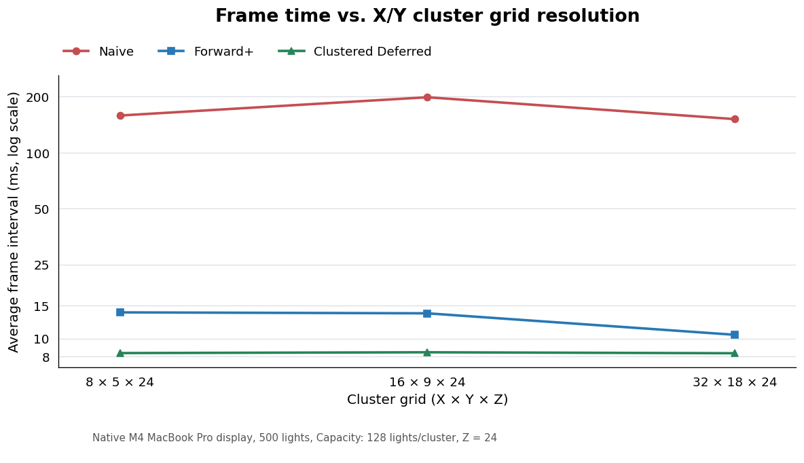
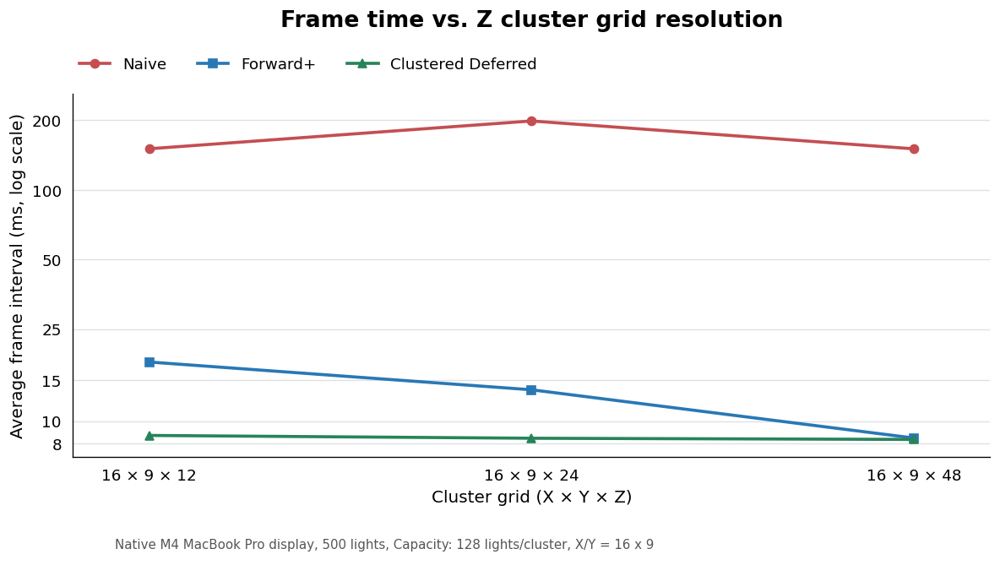
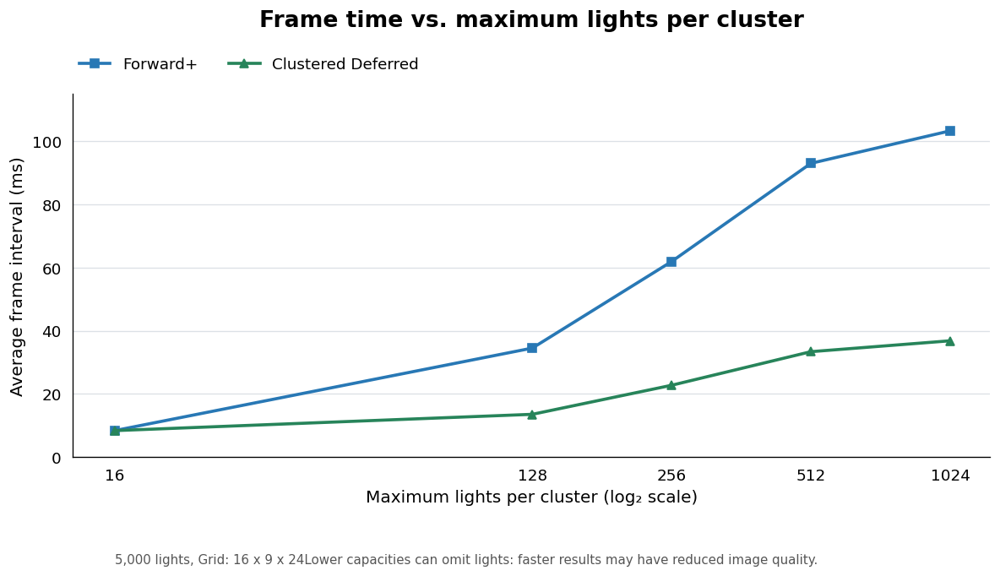
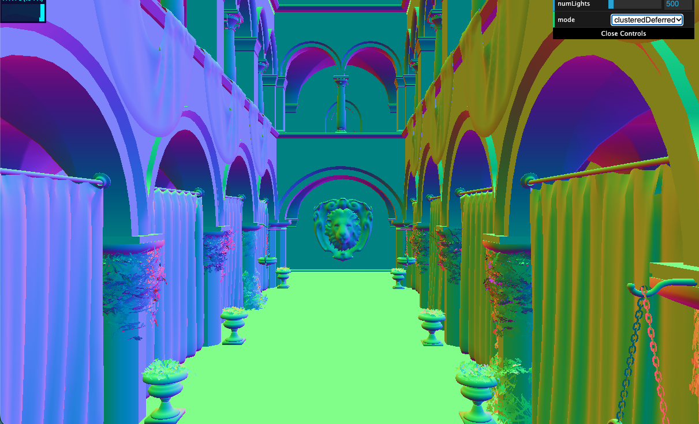
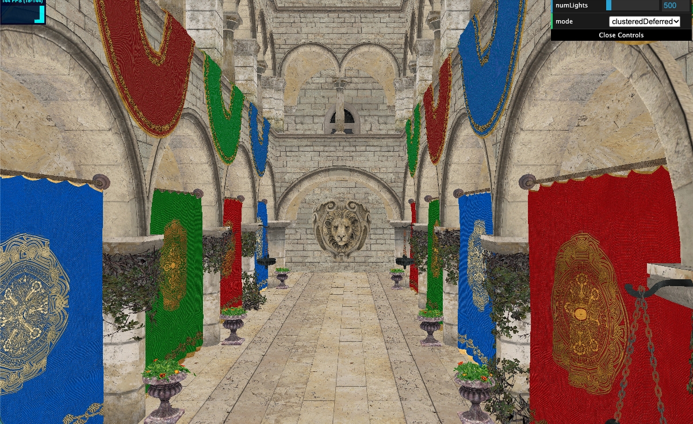
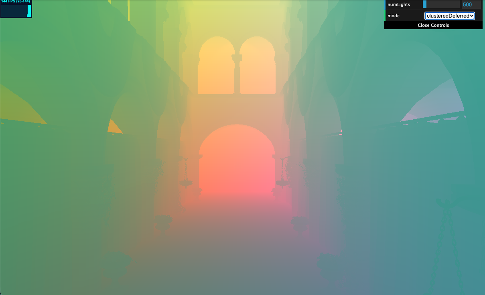
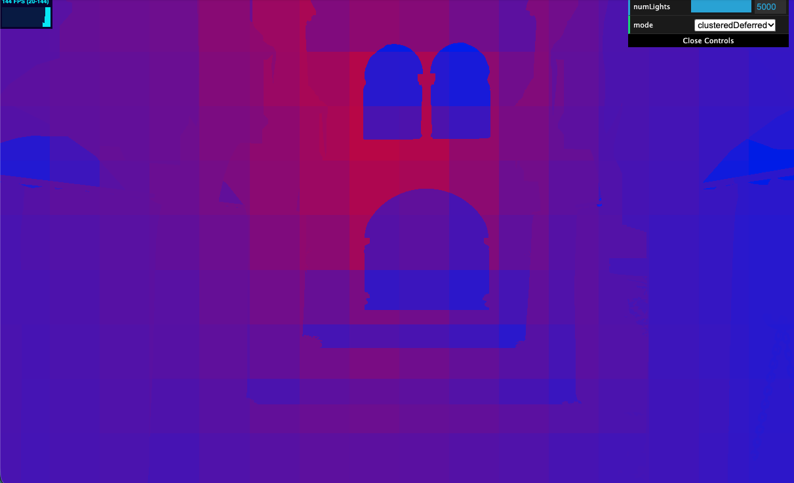

WebGL Forward+ and Clustered Deferred Shading
======================

**University of Pennsylvania, CIS 565: GPU Programming and Architecture, Project 4**

* Rayyan Shaik
* Tested on: (TODO) **Google Chrome 155.0.8059.80** on macOS, Apple M4 10 core, 16GB unified memory, integrated gpu (personal computer)

### Live Demo
[https://rayyanshaik2022.github.io/Project4-WebGPU-Forward-Plus-and-Clustered-Deferred/](https://rayyanshaik2022.github.io/Project4-WebGPU-Forward-Plus-and-Clustered-Deferred/)
### Demo Video/GIF

https://github.com/user-attachments/assets/a53e8ede-b8d5-4227-9f70-59113ff3e9e4

### Overview

This project renders the Sponza atrium scene with thousands of animated point lights to compare the performance and tradeoffs of three lighting-rendeirng approaches. It uses TypeScript to manage GPU resources and rendering passes, with WebGPU and WGSL shaders performing light clustering and shading on the GPU.

Features Implemented
- Naive: Shades each fragment by evaluating every active point light; our baseline.
- Forward+: Uses a compute shader to assign lights to 3D view-space clusters, then shades geometry using only the lights associated with each fragment’s cluster.
- Clustered Deferred: Stores each visible surface’s position, normal, and color in a G-buffer, then calculates lighting in a separate pass using only the lights that overlap its region.

### Performance Analysis
Tests were run on the default Sponza scene at 3024x1964 resolution. Each value is the average frame time over 5 seconds.

#### Number of Lights

As the number of lights increases, we see that Naive becomes much slower because every fragment checks every light. Forward+ improves performance by checking only the lights overlapping each fragment’s cluster, while Clustered Deferred calculates lighting once per visible pixel using the G-buffer. At 5,000 lights, frame times were 556.78 ms for Naive, 35.49 ms for Forward+, and 12.08 ms for Clustered Deferred. These approaches benefit most from many localized lights -- with few lights, clustering and G-buffer overhead can outweigh the savings, although the observed 6.95 ms display limit hides differences at low counts. Larger light lists increase shading work, while smaller cluster capacities can artificially improve performance by dropping lights. A lights-per-cluster debug heatmap can show where lighting work is concentrated (which we might be able to exploit for optimizations).

#### Cluster Grid Resolution

Increasing cluster grid resolution seemed to generally improved performance by giving each fragment a smaller set of lights to evaluate. With 500 lights, increasing the X/Y grid from 8x5x24 to 32x18x24 reduced Forward+ frame time from 13.82 ms to 10.47 ms Increasing depth slices from 12 to 48 reduced it from 18.01 ms to 8.45 ms. Clustered Deferred stayed near 8.3–8.7 ms, and was rather invariant to these changes. "Finer" grids help most when they separate lights into shorter lists, but require more cluster memory and intersection tests. Thus, excessively fine grids can become slower. Naive does not use clusters, so its measured variation reflects other test conditions rather than grid resolution.

#### Max Lights per cluster

Increasing the maximum lights per cluster increased frame time because more lights were retained and evaluated. With 5,000 lights and a 16x9x24 grid, increasing capacity from 16 to 1024 raised Forward+ frame time from 8.33 ms to 103.30 ms and Clustered Deferred from 8.33 ms to 36.79 ms. Smaller capacities were faster but typically omitted lights, causing darker surfaces and visible cluster boundaries (on screen). Larger capacities improve lighting "correctness" at the cost of more memory and shading work; once capacity is sufficient, increasing it further provides no visual benefit. In testing, it seemed that 512 minimally satisifed this. It's expected that the less lights we consider the quicker the rendering will be.

### Testing

| Normals | Albedo |
|:---:|:---:|
|  |  |
| **World Position** | **Lights per Cluster** |
|  |  |

### Credits

- [Vite](https://vitejs.dev/)
- [loaders.gl](https://loaders.gl/)
- [dat.GUI](https://github.com/dataarts/dat.gui)
- [stats.js](https://github.com/mrdoob/stats.js)
- [wgpu-matrix](https://github.com/greggman/wgpu-matrix)
