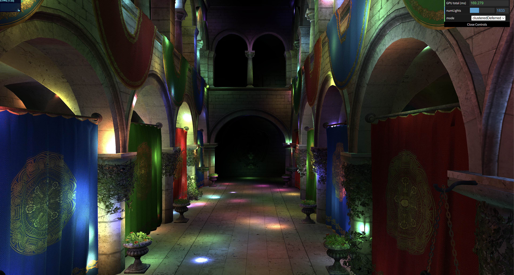
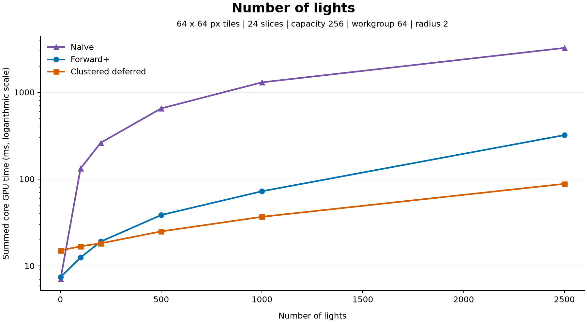
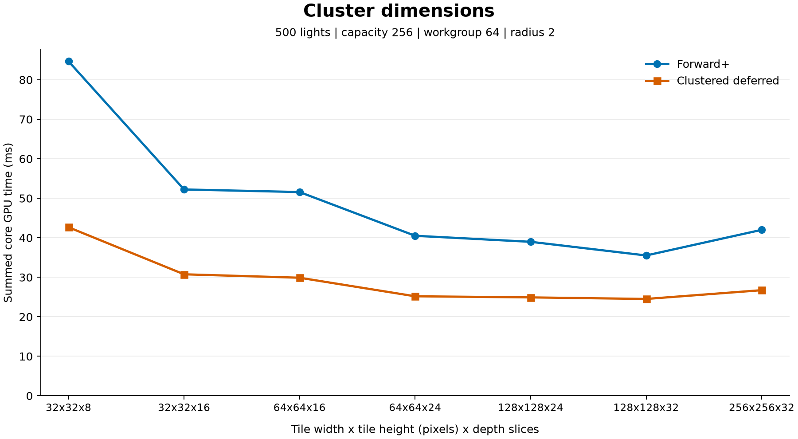
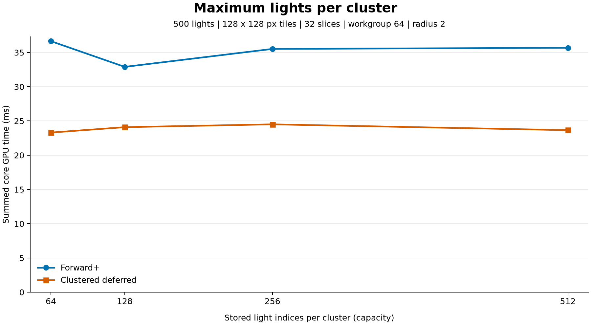
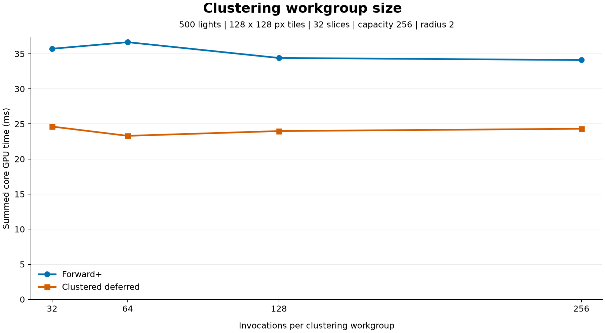
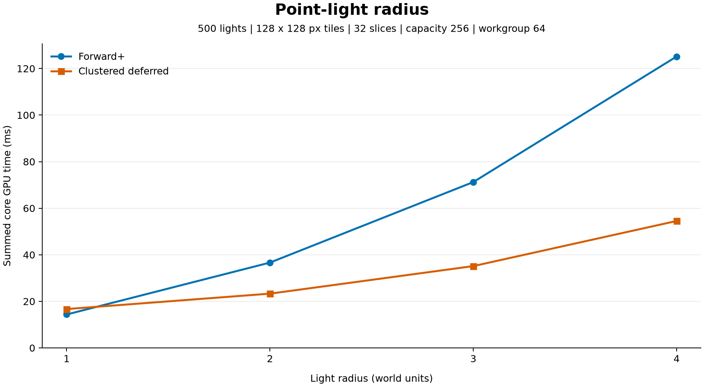

WebGPU Forward+ and Clustered Deferred Shading
======================

**University of Pennsylvania, CIS 565: GPU Programming and Architecture, Project 4**

* Ziqiu Wang
* Tested on: Windows 11 Home, Intel Core Ultra 9 290HX Plus @ 2.7GHz 32GB, RTX 5080 16GB (Personal Computer)

### Live Demo

### Demo GIF

## Project Overview

This project implements three real-time rendering methods through WebGPU. The rendered scene is a Sponza scene with numerous moving point lights.

**Naive forward rendering:** In this classic forward rendering pipeline, a single geometry pass transforms the scene using the camera's view-projection matrix, samples the material, and evaluates every active point light for each shaded fragment. This approach is simple and avoids any clustering or G-buffer overhead, thus making it a useful baseline and a good fit for scenes with very few lights. Its main disadvantage is that lighting work at best scales linearly with the number of lights, so it is impossible to achieve real-time rendering for scenes with many lights.

**Forward+:** This rendering pipeline consists of two passes: a compute pass for clustering and a usual geometry pass. The compute pass first divides the camera frustum into screen-space tiles and logarithmic view-space depth slices, and then assigns lights to those clusters using sphere-AABB intersection tests (since we are only dealing with point lights in this project). Each compute invocation handles one cluster and checks every active light, while the following forward geometry pass shades each fragment using its cluster's light list. By narrowing down the lights that actually influence each cluster, this pipeline greatly reduces unnecessary lighting calculations, but it also adds light assignment work and may still evaluate lighting for fragments that later geometry occludes due to the lack of a depth prepass or G-buffers. To ensure the illumination remains correct, the fixed-capacity light lists fall back to evaluating all active lights when they overflow.

**Clustered deferred rendering:** This method runs the same clustering compute pass as Forward+ and then a geometry pass that writes world position, normal, and albedo into G-buffers. A fullscreen lighting pass then loads the visible fragment data and evaluates the corresponding cluster's lights, using the same overflow behavior as Forward+. This pipeline ensures lighting runs only once per pixel, which can save work when lighting or overdraw is expensive, but the extra pass and G-buffer writes/reads introduce bandwidth and storage costs.

## Performance Analysis

Timing uses WebGPU timestamp queries at the beginning and end of each core compute/render pass. The final sum excludes gaps between passes, CPU command encoding, light animation, and timestamp resolve/readback work, so it measures the core GPU execution.

| Method | Reported GPU time |
| --- | --- |
| Naive | Geometry and lighting pass |
| Forward+ | Clustering compute pass + forward pass |
| Clustered deferred | Clustering compute pass + G-buffer geometry pass + fullscreen lighting pass |

Each measurement is the average of three timed frames after a 10-second wait for the values to stabilize. All times below are milliseconds, with lower values indicating faster execution.

### Number of Lights

Fixed parameters: **64 x 64-pixel tiles, 24 depth slices, light list capacity 256, clustering workgroup size 64, and light radius 2**.

| Number of lights | Naive (ms) | Forward+ (ms) | Clustered deferred (ms) |
| ---: | ---: | ---: | ---: |
| 1 | 7.078 | 7.406 | 15.021 |
| 100 | 132.383 | 12.458 | 16.777 |
| 200 | 261.685 | 19.005 | 18.153 |
| 500 | 650.707 | 38.470 | 24.904 |
| 1000 | 1300.103 | 72.286 | 36.700 |
| 2500 | 3238.855 | 320.602 | 87.949 |

Naive rendering is fastest with one light, where clustering adds work without removing many light evaluations. Its time then grows approximately linearly with light count because every shaded fragment loops over all active lights. Forward+ is the fastest measured method at 100 lights, while clustered deferred first becomes faster at 200 lights. At 2500 lights, clustered deferred is 36.83x faster than naive and 3.65x faster than Forward+.

The clustered methods benefit from evaluating shorter light lists, although their assignment pass still checks every light for every cluster. Deferred rendering's G-buffer and fullscreen pass impose overhead at low light counts, but that overhead becomes easier to amortize as lighting gets more expensive. Its larger advantage at high light counts is consistent with avoiding repeated lighting of fragments that later geometry occludes. Forward+ increases by 4.44x between 1000 and 2500 lights despite only a 2.5x increase in light count, suggesting an additional loss of culling efficiency at high light counts. One possible cause for this is more clusters overflowing the 256-entry light lists and reverting to all-light shading.

### Cluster Dimensions

Fixed parameters: **500 lights, light list capacity 256, clustering workgroup size 64, and light radius 2**. Dimensions below mean (tile width in pixels) x (tile height in pixels) x (number of depth slices in the z direction).

| Tile width x tile height x depth slices | Forward+ (ms) | Clustered deferred (ms) |
| --- | ---: | ---: |
| 32 x 32 x 8 | 84.673 | 42.664 |
| 32 x 32 x 16 | 52.232 | 30.753 |
| 64 x 64 x 16 | 51.577 | 29.884 |
| 64 x 64 x 24 | 40.507 | 25.188 |
| 128 x 128 x 24 | 38.978 | 24.906 |
| 128 x 128 x 32 | 35.521 | 24.510 |
| 256 x 256 x 32 | 42.009 | 26.732 |

Both methods have their lowest measured time at 128 x 128-pixel tiles with 32 depth slices: 35.521 ms for Forward+ and 24.510 ms for deferred. Compared with 32 x 32 x 8, these times are lower by 58.0% and 42.6% respectively. At a fixed 32 x 32 tile size, increasing the slices from 8 to 16 substantially improves both methods, consistent with narrower depth intervals removing irrelevant lights from fragment lists. Moving from 64 x 64 x 16 to 64 x 64 x 24 gives the same directional improvement. More slices increase the number of cluster-light tests, so these results suggest that shorter lighting lists outweigh that extra assignment cost over the tested range.

At fixed depth-slice counts, increasing tile width and height reduces the number of clusters and therefore assignment work, but makes each cluster cover more screen area. This explains why a coarser XY grid may improve total time even though its light lists may become longer. Increasing tiles from 128 x 128 to 256 x 256 at 32 slices reverses the improvement: Forward+ becomes 18.3% slower and deferred becomes 9.1% slower. Again, capacity overflows due to longer light lists and more false positives for AABB testing are likely reasons for this reversal. Clustered deferred is faster at every tested configuration, and 128 x 128 x 32 seems to be the best measured tradeoff here.

### Maximum Number of Lights per cluster (List Capacity)

Fixed parameters: **500 lights, 128 x 128-pixel tiles, 32 depth slices, clustering workgroup size 64, and light radius 2**.

| Maximum stored lights per cluster | Forward+ (ms) | Clustered deferred (ms) |
| ---: | ---: | ---: |
| 64 | 36.652 | 23.306 |
| 128 | 32.899 | 24.096 |
| 256 | 35.521 | 24.510 |
| 512 | 35.685 | 23.658 |

Clustered deferred is faster at every tested capacity, but neither method shows a consistent improvement as capacity increases. Forward+ has its lowest measured time at 128 entries, while deferred has its lowest at 64 entries. The differences here are therefore likely due to measurement error given the absense of an obvious trend. Light motion and run-to-run variation may have contributed to this error.

### Cluster Workgroup Size

Fixed parameters: **500 lights, 128 x 128-pixel tiles, 32 depth slices, capacity 256, and light radius 2**.

| Invocations per workgroup | Forward+ (ms) | Clustered deferred (ms) |
| ---: | ---: | ---: |
| 32 | 35.717 | 24.625 |
| 64 | 36.652 | 23.306 |
| 128 | 34.406 | 23.987 |
| 256 | 34.109 | 24.314 |

Clustered deferred remains faster for all four workgroup sizes. Forward+ has its lowest measured time at 256 invocations, while deferred has its lowest at 64, so the measurements do not identify one shared winner. The observed spreads are approximately 7.5% and 5.7% relative to the minimum time for each method. These differences are relatively insignificant compared with the light count and light radius effects (see below), so we may conclude that cluster workgroup size does not have noticeable impact on performance. Again, the differences in the timing data are likely due to measurement errors.

The implementation assigns one global invocation to each cluster, so changing workgroup size changes how those invocations are grouped rather than how many clusters or lights are processed. There is no light cache that is shared between workgroups that would reduce the number of sphere-AABB tests at larger sizes, so it is reasonable to not see any significant impact.

### Light Radius

Fixed parameters: **500 lights, 128 x 128-pixel tiles, 32 depth slices, capacity 256, and clustering workgroup size 64**.

| Light radius | Forward+ (ms) | Clustered deferred (ms) |
| ---: | ---: | ---: |
| 1 | 14.358 | 16.684 |
| 2 | 36.652 | 23.306 |
| 3 | 71.238 | 35.139 |
| 4 | 125.174 | 54.526 |

Forward+ is 13.9% faster than clustered deferred at radius 1, where short light lists keep forward lighting inexpensive while deferred still pays the G-buffer and fullscreen-pass costs. However, deferred becomes faster at radius 2 and increases its advantage as the radius grows. At radius 4, deferred takes 56.4% less time than Forward+, or a 2.30x speedup. Across the full radius range, Forward+ time grows by 8.72x, while deferred grows only by 3.27x.

Increasing radius makes each light overlap more clusters and causes each fragment's list to contain more lights, thereby increasing both light-index writes and lighting work. However, the reason why we see deferred being faster is that deferred computes lighting only for the final visible fragments while Forward+ does not avoid such overdraws.

### Credits

- [Vite](https://vitejs.dev/)
- [loaders.gl](https://loaders.gl/)
- [dat.GUI](https://github.com/dataarts/dat.gui)
- [stats.js](https://github.com/mrdoob/stats.js)
- [wgpu-matrix](https://github.com/greggman/wgpu-matrix)
- [Matplotlib](https://matplotlib.org/) for the performance graphs
