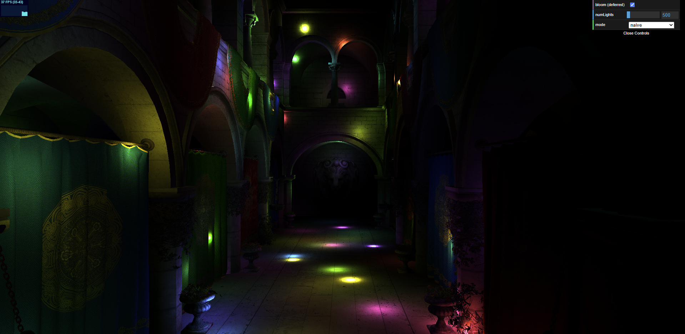
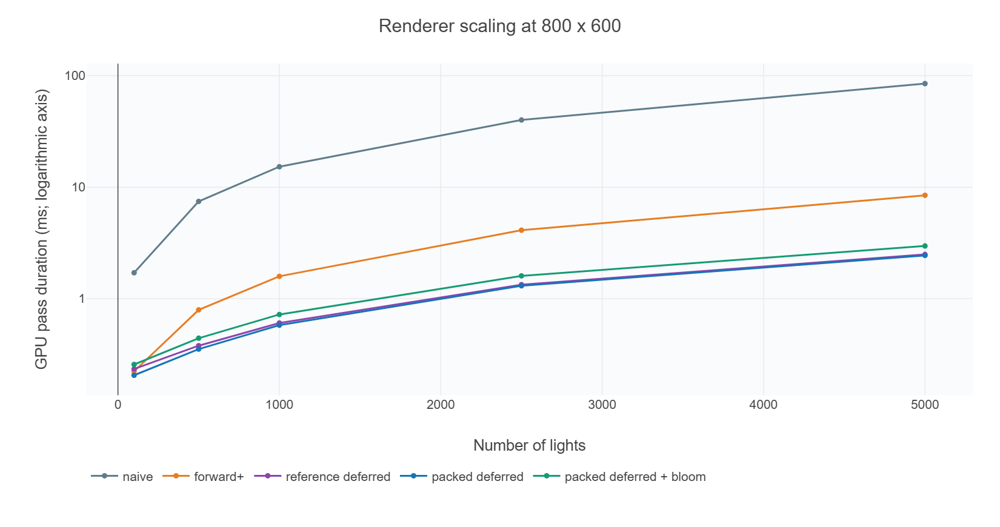
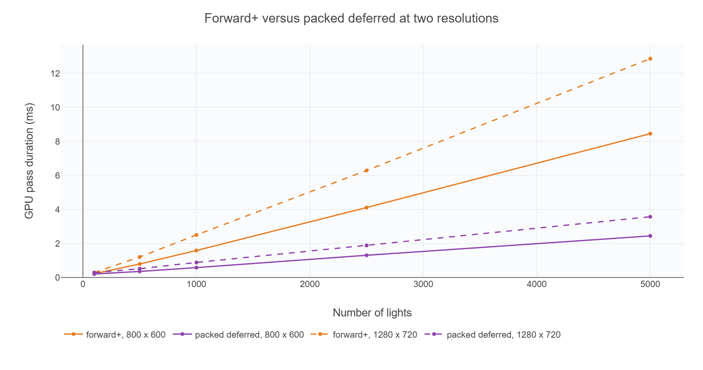
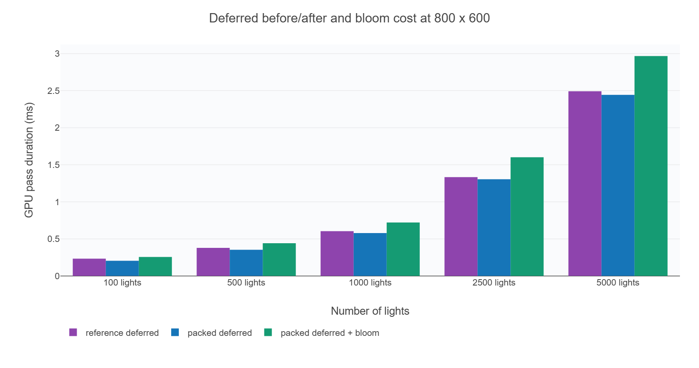
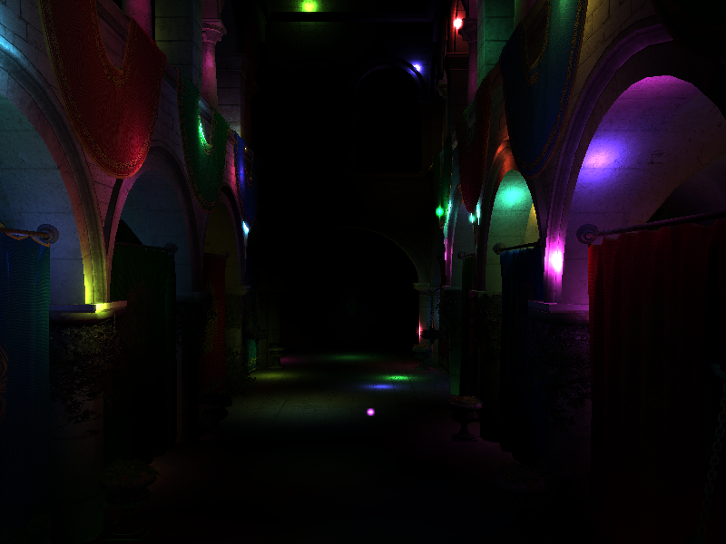
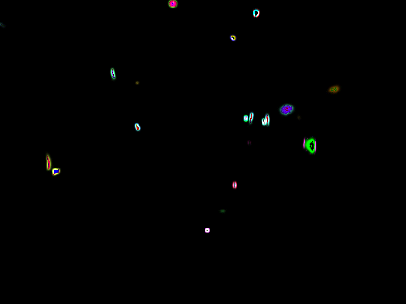
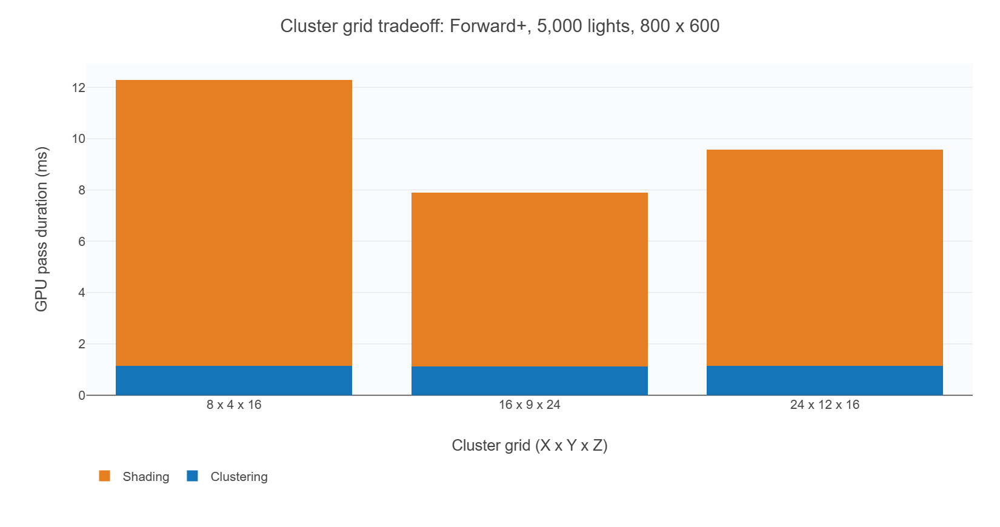
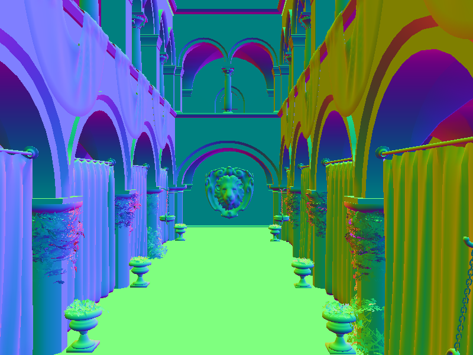

# WebGPU Forward+ and Clustered Deferred Shading

**University of Pennsylvania, CIS 5650: GPU Programming and Architecture - Project 4**

**Author:** [Rithik Rajaram](https://github.com/RithikR)

An interactive WebGPU renderer of Sponza with up to 5,000 animated point lights. It compares naive forward shading, clustered Forward+, and clustered deferred shading. The deferred path also implements compute lighting, a packed G-buffer, and optional compute-based Gaussian bloom.

[Live demo](https://rithikr.github.io/Project4-WebGPU-Forward-Plus-and-Clustered-Deferred/)

[Watch/download the 55-second demonstration](demo.mp4)

The recording demonstrates renderer switching, changing light counts, camera movement, and the deferred bloom toggle. The three lighting methods aim to produce the same image; their main difference is the amount and organization of rendering work. Bloom adds glow around highlights and is subtle at the default settings.

## Implemented features

| Requirement | Implementation |
| --- | --- |
| Naive renderer | Uploads camera matrices through a uniform buffer, binds them in the scene group, and evaluates every active light per fragment. |
| Forward+ | Builds view-space cluster AABBs and light-index lists in a compute pass. Fragment shading evaluates only the overlapping cluster's lights. |
| Clustered deferred | Reuses the same clustering pass, rasterizes surface attributes into a G-buffer, and lights the visible pixels separately. |
| Extra: post-processing | Bright-pass extraction, separable Gaussian blur, and bloom compositing all run in compute passes. |
| Extra: compute deferred lighting | One compute lighting pass replaces the fullscreen vertex/fragment lighting pipeline. |
| Extra: packed G-buffer | One `rgba32uint` color output stores 16 bytes per pixel: full-precision albedo RGB and a packed octahedral normal. Position is reconstructed from depth. |

### Clustering and shading

The default grid is **16 x 9 x 24** (3,456 clusters). X and Y divide the screen uniformly; Z uses logarithmic slices between the camera's 0.1 and 1,000 near/far planes. Each compute invocation unprojects a cluster's corner rays, evaluates their positions at the two depth bounds, and stores the enclosing view-space AABB. Each light's radius-two sphere is tested against that AABB using squared distance to its closest point.

A cluster stores its bounds, light count, and indices in ascending light order. Each list has space for all 5,000 supported lights. The WGSL layout is `minBounds` at byte 0, `maxBounds` at byte 16, count at byte 28, and indices at byte 32, with a 20,032-byte stride aligned to 16 bytes. The default grid reserves 69,230,592 bytes (66.02 MiB) to handle the worst case of every light overlapping every cluster.

Forward+ derives the cluster from the fragment's screen position and view depth. Deferred reconstructs the visible world position from the sampled depth and inverse view-projection matrix, then uses the same cluster lookup. Both preserve the supplied attenuation function, material alpha discard, and light movement. Shader code accesses cluster lists through pointers to avoid copying their large arrays. The naive and Forward+ paths retain the starter geometry/material traversal.

## Performance analysis

### Method

Test system: Google Chrome 155.0.8059.80, Windows 11 Home, Intel Core i9-12900K, 32 GiB RAM, and NVIDIA GeForce RTX 3080 Ti.

An automated benchmark measured GPU pass durations in headless Chrome using WebGPU timestamp queries. The camera, light-animation time (1,000 ms), and random seed (565) were fixed. Each mode received 15 warmup draws and 40 samples; variants were interleaved and their order rotated between rounds. Results are median sums of GPU pass durations, including clustering for clustered renderers. Light movement was excluded because it runs in a separate submission.

All timings are in milliseconds and exclude CPU work, presentation, and gaps between GPU passes. GPU load can affect the measurements, and medians can vary between runs. The first plot uses a logarithmic vertical axis.

### Naive, Forward+, and deferred

| Lights | Naive | Forward+ | Reference deferred | Packed deferred, bloom off | Packed deferred, bloom on |
| --- | ---: | ---: | ---: | ---: | ---: |
| 100 | 1.709 ms | 0.223 ms | 0.234 ms | 0.206 ms | 0.257 ms |
| 500 | 7.439 ms | 0.794 ms | 0.379 ms | 0.353 ms | 0.442 ms |
| 1,000 | 15.249 ms | 1.587 ms | 0.605 ms | 0.580 ms | 0.722 ms |
| 2,500 | 39.999 ms | 4.110 ms | 1.334 ms | 1.305 ms | 1.602 ms |
| 5,000 | 84.795 ms | 8.452 ms | 2.491 ms | 2.443 ms | 2.968 ms |

At 5,000 lights and 800x600, Forward+ reduces the measured GPU pass sum by about 10x relative to naive. Packed deferred without bloom is about 3.46x faster than Forward+ in this view. The naive loop scales with all lights even when they contribute nothing. Clustering reduces that list, but Forward+ can still perform lighting on multiple overlapping fragments before depth rejection. Deferred writes surface data first and applies lighting to the final visible pixel, which is useful in Sponza's overlapping geometry.

At low light counts, clustering, G-buffer traffic, and dispatch costs form a larger fraction of the work. Forward+ can be competitive or preferable for scenes with little overdraw, expensive G-buffer bandwidth, or requirements such as conventional forward transparency. Deferred should benefit most when many expensive lights and overlapping opaque surfaces dominate. It carries intermediate storage, packing/reconstruction, and depth/format management costs. The scene's alpha-cutout materials are supported; general blended transparency is not added here. These workload explanations are architectural expectations; the measured comparisons are for the fixed Sponza view, not proof for every scene.

### Resolution

At 5,000 lights, increasing resolution from 800x600 to 1280x720 raises Forward+ from 8.452 to 12.855 ms and packed deferred from 2.443 to 3.570 ms. More pixels increase shading and image traffic; clustering still uses the same grid. At 1280x720 the reference and packed deferred paths are essentially tied at 3.566 and 3.570 ms, so compression is not a guaranteed overall speedup.

### G-buffer optimization and compute lighting

The reference measurements used the earlier three-attachment G-buffer and fullscreen vertex/fragment lighting pass, with the same scene, lights, cluster buffer, and camera as the final renderer.

The final renderer uses one compute lighting pass with 8x8 workgroups. It reads the packed attributes and depth, reconstructs world position using the inverse view-projection matrix, evaluates the cluster's lights, and writes an `rgba16float` HDR image. The subsequent bloom/composite passes do not repeat light evaluation. Canvas output uses `rgba8unorm` storage writes, avoiding a dependency on the optional `bgra8unorm-storage` device feature.

| G-buffer attachment | Format | Contents |
| --- | --- | --- |
| One color output | `rgba32uint` | Albedo RGB as three float32 bit patterns; an octahedral normal packed into the fourth word with `pack2x16snorm` |
| Depth | `depth32float` | Background rejection and world-position reconstruction |

The color attachment occupies one `vec4u` (16 bytes) per pixel. There are no separate world-position or normal textures; the lighting shader decodes the normal and reconstructs position from depth.

At 800x600 with 500 lights, the G-buffer pass decreases from **0.154 to 0.103 ms**. The lighting stage changes from approximately **0.112 ms** for fullscreen raster lighting to **0.115 ms** for compute lighting; the final HDR composite adds **0.020 ms**. The total changes from **0.379 to 0.353 ms**, approximately a 6.8% reduction. At 5,000 lights it changes from **2.491 to 2.443 ms**, approximately a 1.9% reduction. The smaller attachments reduce the geometry pass's writes, while decoding and an extra HDR-to-canvas composite offset part of that saving. This comparison combines packing and compute conversion; it does not isolate each one's individual contribution.

Color-attribute storage falls from **32 to 16 bytes per pixel**, a 50% reduction. Depth is separate. Bloom needs two 8-byte scratch images and lighting uses an 8-byte HDR output, so total renderer image memory is not reduced by 50%. At 800x600 those three additional images require about 10.99 MiB. Compression should help most when G-buffer traffic is limiting; it can yield little improvement when clustering or lighting dominates. Albedo is retained at float32 precision, while normal packing and depth reconstruction introduce numerical error near strong point-light highlights.

### Bloom

Bloom extracts luminance above **0.7**, applies a nine-tap horizontal Gaussian with sigma **2**, applies the corresponding vertical blur, and adds **0.65** times the blurred image to HDR lighting. Each stage is compute-based. Two one-dimensional kernels use 18 texture samples per pixel instead of 81 for a nine-by-nine kernel. Separate passes and images avoid read/write hazards.

Blur sampling clamps at image boundaries, and compute invocations outside the image return immediately. Disabling bloom skips the two blur passes and sets the composite's bloom strength to zero.

| Lights at 800x600 | Bloom off | Bloom on | Difference |
| --- | ---: | ---: | ---: |
| 100 | 0.206 ms | 0.257 ms | +0.051 ms |
| 500 | 0.353 ms | 0.442 ms | +0.089 ms |
| 1,000 | 0.580 ms | 0.722 ms | +0.142 ms |
| 2,500 | 1.305 ms | 1.602 ms | +0.297 ms |
| 5,000 | 2.443 ms | 2.968 ms | +0.524 ms |

The two blur passes measure approximately **0.039-0.041 ms** together at 800x600, nearly independent of light count. The full-pipeline difference is larger and grows with light count. Clustering-pass durations also increased in the bloom runs despite using the same clustering shader and dispatch. The cause was not isolated; the table includes this measured cost.

The Gaussian kernel has a radius of four pixels and only spreads light from bright regions. The glow can be subtle at high display resolutions. These images use the same frozen scene:

| Bloom off | Bloom on |
| --- | --- |
|  |  |

The last image amplifies the RGB difference by 8x for inspection; it is not the final display output. Bloom scales with image size and kernel radius, not the number of lights. Dark input still executes the enabled blur passes; bloom does not provide a performance improvement. Future options include downsampled or multiscale blur, adjustable radius/threshold/strength, and a direct canvas output when bloom is disabled to eliminate the otherwise necessary HDR composite.

### Cluster dimensions and debug views

All grid measurements use Forward+, 5,000 lights, and 800x600. Both screen and depth partitioning change here, so this experiment compares grid configurations rather than isolating only cluster count.

| Grid | Clusters | Cluster storage | Mean lights/cluster, including empty clusters | Max lights/cluster | Median total |
| --- | ---: | ---: | ---: | ---: | ---: |
| 8 x 4 x 16 | 512 | 9.78 MiB | 226.2 | 1,360 | 12.259 ms |
| 16 x 9 x 24 | 3,456 | 66.02 MiB | 163.9 | 941 | 7.933 ms |
| 24 x 12 x 16 | 4,608 | 88.03 MiB | 190.7 | 1,176 | 9.737 ms |

The default grid gives the lowest time of these three configurations. Large clusters conservatively admit more lights, increasing fragment work. Increasing X/Y while reducing Z is not necessarily better: logarithmic depth resolution matters too. More clusters also reserve more list storage and perform more intersection tests. Sphere/AABB culling is conservative, so the lists can include lights that do not actually intersect the cluster frustum; it must not exclude lights that do affect it. A tighter frustum test, cached bounds, or more compact list allocation could improve this tradeoff.

| Decoded packed normals | Cluster light counts at visible pixels |
| --- | --- |
|  |  |

The normal view maps [-1,1] to [0,1]. The cluster view maps zero lights to blue and 1,000 or more to red, with black for background. The block boundaries reflect the screen/depth cluster grid. Regions with more listed lights require more lighting iterations. The colors indicate local lighting work, rather than measured time.
