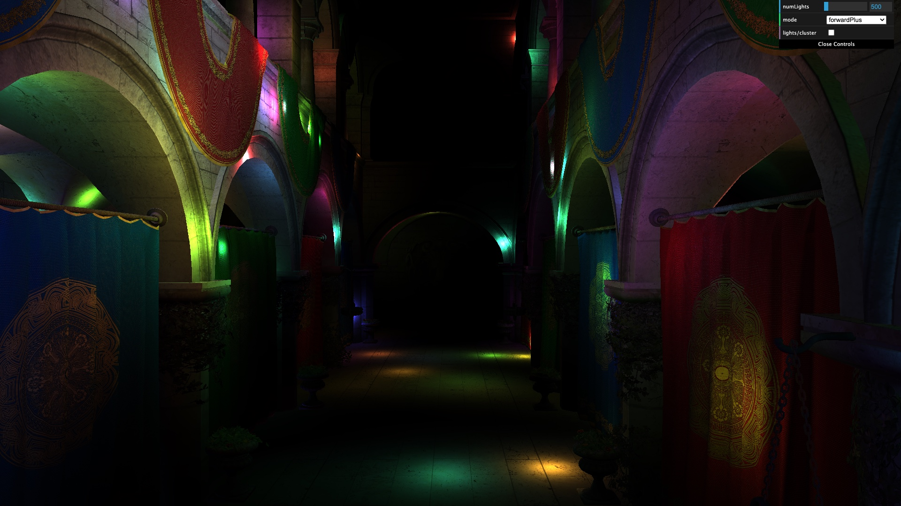
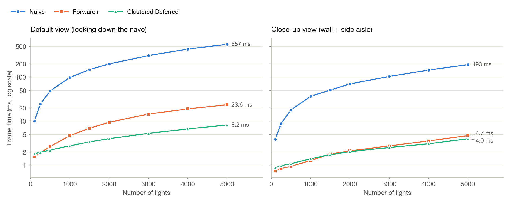
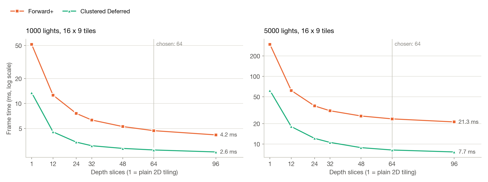
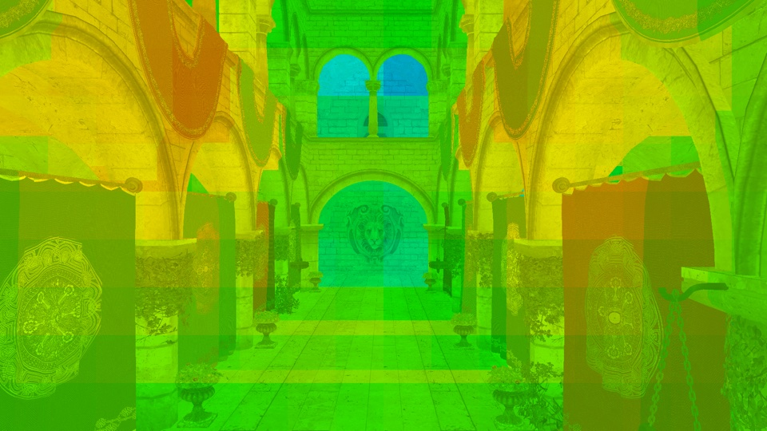
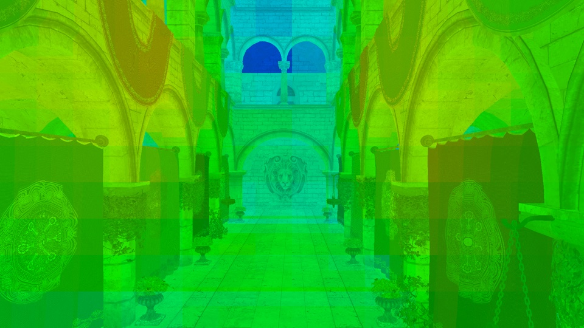

WebGPU Forward+ and Clustered Deferred Shading
==============================================

**University of Pennsylvania, CIS 5650: GPU Programming and Architecture, Project 4**

* Hangyu Zhang
* Tested on: Google Chrome 155 on macOS 15.7, Apple M4 Pro (20-core GPU), 48 GB

### Live Demo

https://otaku-hy.github.io/Project4-WebGPU-Forward-Plus-and-Clustered-Deferred/

### Demo Video/GIF

img/video.mp4

## Features

- **Naive**: camera uniform buffer, bind group and shaders. Every fragment loops over every light.
- **Light clustering** (compute shader): the view frustum is split into 16 x 9 screen tiles x 64 exponentially spaced depth slices. Each cluster gets the list of lights whose radius overlaps its bounding box (up to 2047 lights per cluster).
- **Forward+**: each fragment only loops over the lights in its own cluster.
- **Clustered Deferred**: a G-buffer pass stores position (`rgba32float`), normal (`rgba16float`) and albedo (`rgba8unorm`), then a fullscreen pass lights each pixel once, using the same clusters.
- **Debug view**: the `lights/cluster` checkbox colors each pixel by how many lights its cluster has (blue = 0, green ~ 45, yellow ~ 300, red = full).
- **Build fix**: the base code evaluated shaders with `eval`, so Rollup removed constants that only shaders use (like `lightRadius`). The dev server worked, but the production build that GitHub Pages deploys had broken shaders. Passing `constants` into `new Function(...)` fixes it.

## Performance Analysis

All numbers are frame times at 1920 x 1080. I drove headless Chrome with a script that renders frames back to back (no vsync) with a fixed animation clock, so every renderer sees the same lights. Per-pass times come from WebGPU timestamp queries. I used two camera views: the **default** camera looking down the nave (lots of overdraw), and a **close-up** where a wall fills the screen. Forward+ produces exactly the same image as Naive.

### Forward+ vs. Clustered Deferred

| Lights (default view) | Naive | Forward+ | Clustered Deferred |
|---:|---:|---:|---:|
| 100 | 10.0 ms | **1.56 ms** | 1.82 ms |
| 500 | 48.8 ms | 2.67 ms | **2.21 ms** |
| 1000 | 98.2 ms | 4.67 ms | **2.75 ms** |
| 5000 | 557 ms | 23.6 ms | **8.20 ms** |

- **Both are much faster than Naive**: at 5000 lights, 24x for Forward+ and 68x for Deferred.
- **Which one wins depends on the scene.** In the default view, Deferred is faster above about 300 lights (2.9x at 5000). In the close-up view, Forward+ is faster up to about 1000 lights (0.94 vs. 1.08 ms at 500), and Deferred is only 1.18x faster at 5000.
- **Why: overdraw.** I counted shaded fragments with an additive-blending version of the Forward+ pass: 2.94 fragments per pixel in the default view and 1.38 in the close-up. Forward+ runs the light loop for every shaded fragment, while Deferred runs it once per pixel. At 5000 lights, Forward+'s shading pass takes 23.1 ms and Deferred's lighting pass 7.6 ms, the same ~3x ratio. In return, Deferred pays for its G-buffer pass (about 1.2 ms in the default view), which is why Forward+ wins when there are few lights or little overdraw. The clustering pass costs the same for both (0.06 ms at 500 lights, 0.6 ms at 5000).
- **Tradeoffs.** Deferred needs 28 bytes per pixel of extra G-buffer memory (55 MiB at 1080p), makes transparency and MSAA hard, can only shade with what's stored in the G-buffer, and loses a little precision (8-bit albedo). Forward+ has none of these problems, but it pays for overdraw.
- **Resolution.** Both scale roughly linearly with pixel count: going from 1080p to 4K (4x the pixels) at 5000 lights costs Forward+ 3.2x and Deferred 3.6x.

### Cluster grid size

- **Depth slices matter most.** With 1 slice (plain 2D tiles), each tile collects every light along its view rays, and Forward+ takes 296 ms at 5000 lights. 24 slices bring it to 36.6 ms and 64 slices to 23.6 ms.
- **More screen tiles help much less.** At 64 slices, going from 16 x 9 to 32 x 18 tiles saves only 2 ms for Forward+, and it triples the clustering pass time (0.6 to 1.8 ms).
- **I chose 16 x 9 x 64**, after which the gains flatten out. The cluster buffer is 72 MiB.

The debug view shows why. With 24 slices each cluster is about 3x deeper, so it collects more lights (more yellow), and every fragment loops over more of them:

| 24 slices, 1000 lights: Forward+ 7.6 ms | 64 slices, 1000 lights: Forward+ 4.7 ms |
|---|---|
|  |  |

### Optimizations

| Change (5000 lights) | Before | After |
|---|---:|---:|
| 24 -> 64 depth slices (Forward+ frame) | 36.6 ms | 23.6 ms |
| Exponential instead of linear depth slices (Forward+ frame) | 201 ms | 23.3 ms |
| Share lights through workgroup memory (clustering pass) | 1.00 ms | 0.60 ms |
| Read the cluster through a pointer instead of copying it (Forward+ shading) | 22.9 ms | 22.9 ms |

- The original 24-slice grid, with room for only 1023 lights per cluster, also **overflowed at 5000 lights**. Dropped lights showed up as dark rectangles. The finer grid plus a capacity of 2047 fixed it.
- In the clustering pass, each workgroup now loads and transforms 64 lights once into shared memory, instead of every thread reading every light.
- The pointer change made no difference on this machine; the Metal compiler seems to remove the copy on its own. Clustering workgroup size (32 to 256) didn't matter either.
